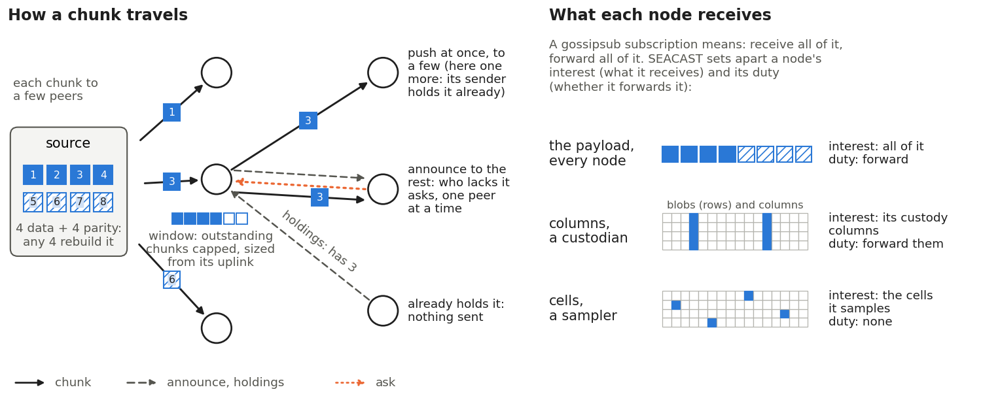
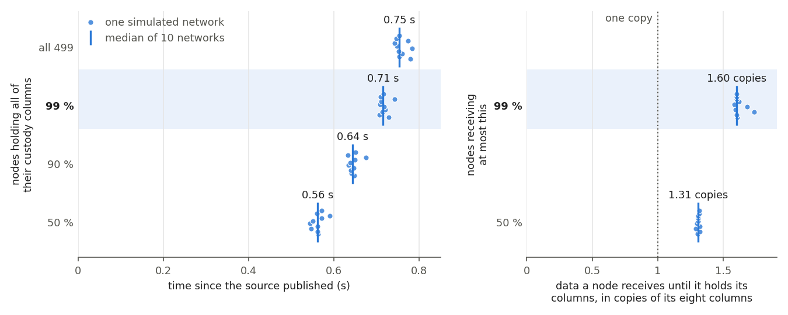
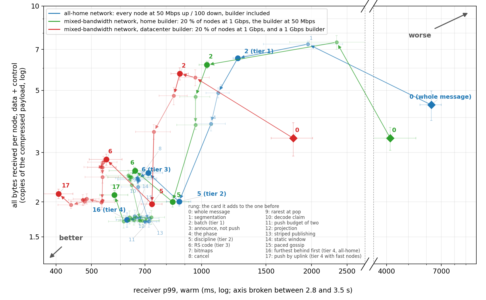
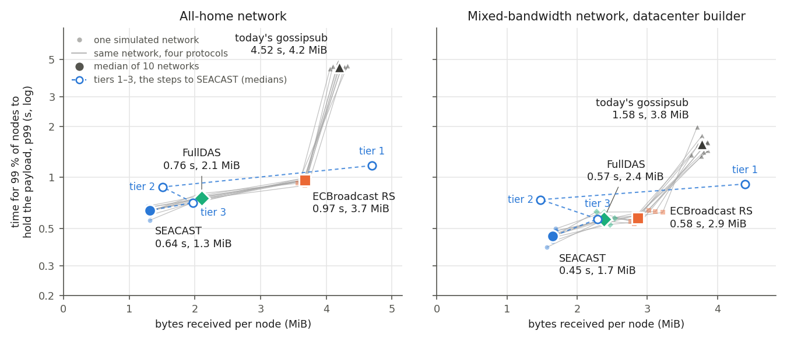
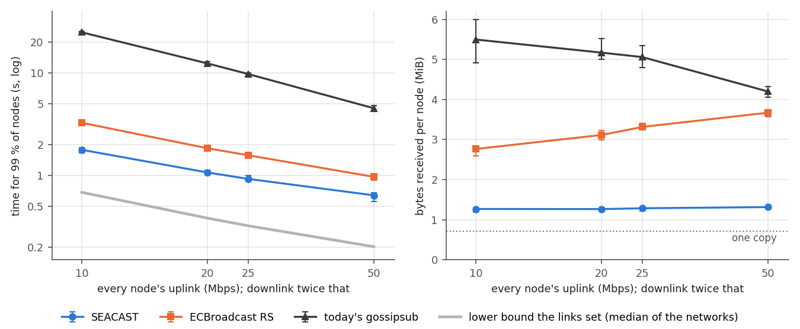
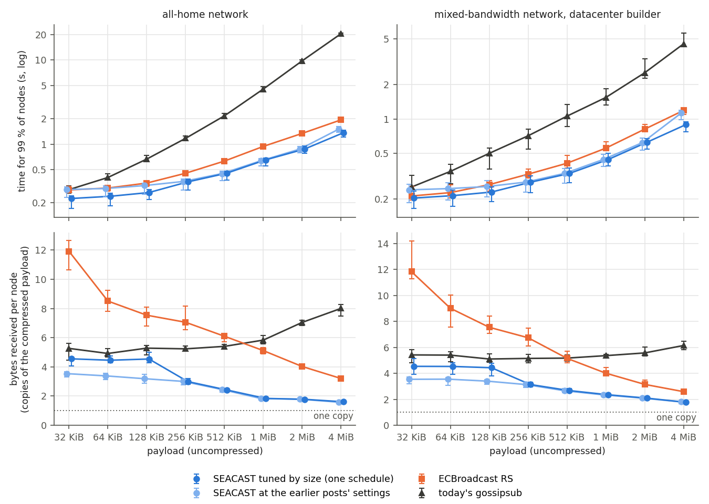

# SEACAST: fast, lean, sampled broadcast for Ethereum, with an executable spec and a formal model

*This is the living version of SEACAST's announcement on ethresear.ch, [posted on 21 October 2026](https://ethresear.ch/t/seacast-fast-lean-sampled-broadcast-for-ethereum-with-an-executable-spec-and-a-formal-model/26167), which stays as published there; this text is kept current. Version 3, 26 November 2026: SEACAST tuned by payload size (§5), and the specification at version 0.12.0, which names its two protocols: SEACAST, and SEACAST Lite, the protocol the post measured (§1). Like the post, this text calls SEACAST Lite simply SEACAST wherever it reports a measurement, a check against the implementation, the formal model or a proof. The measurements ran on the research implementation, and the specification has moved on since: its [changelog](https://github.com/cskiraly/seacast-spec/blob/v0.12.0/CHANGELOG.md) lists each version. Earlier versions of this text are listed at its end.*

*This post follows [Informed Diffusion: making home builders publish fast](https://ethresear.ch/t/informed-diffusion-making-home-builders-publish-fast/26151) (2026).*

## TL;DR

- **Ethereum has more and more large objects to broadcast, and little time for each.** Today's payloads are small and datacenters carry them, which is much of why mainnet is in time, but payloads grow (with gas increase and block-level access lists, BALs) and timelines shrink (with quick slots). Execution proofs and consensus blocks with post-quantum signatures may soon join the large-message club too.
- **Today's delivery method (gossipsub) sits far from being optimal**: every node waits for the whole object before passing it on, and receives several copies of it. From a builder at home, the last nodes receive a 1 MiB payload seconds late.
- **Not every node needs every byte.** With data-availability sampling, a node is to receive its samples of an object, not the object. PeerDAS's 128 column topics are only one way of doing sampled diffusion; RowDAS and FullDAS are other examples. Moreover, broadcast is just the special case of sampled diffusion in which each node's sample is the whole object.
- **SEACAST** (Segmented, Encoded, Availability-sampled broadCAST) is a protocol for handling both sampled diffusion and broadcast. It builds on the principles of Informed Diffusion, the protocol of our last post, and on FullDAS, our earlier design.
- **SEACAST is elastic.** Cut every uplink from 50 to 10 Mbps, to a fifth, and SEACAST takes under three times as long (1.8 s instead of 0.64), with the same bytes. Gossipsub takes five and a half times as long, 25 s, and sends more.
- **SEACAST has an executable specification,** which, to the best of our knowledge, none of the protocols it is compared with has. The pseudocode runs as written in a small simulator, and it is checked rule by rule against the Go implementation the post's numbers come from.
- **SEACAST has a formal model.** A formal model of the specification checks some of its safety rules. The model is not exhaustive and is still a first version, but it has already allowed us to find gaps in delivery, promise handling and expiry. The model is published with the specification.
- **It is measured, across multiple simulators, and against today's gossipsub, ECBroadcast and FullDAS.** SEACAST is faster and lighter than all three, on every simulated network. In our simulator, on a network of 50 Mbps nodes, 99 % of the nodes hold a 1 MiB payload after 0.64 s with SEACAST, 0.76 s with FullDAS (every node sampling every cell), 0.97 s with ECBroadcast and 4.5 s with gossipsub, and SEACAST uses about 60 % of FullDAS's bytes and about 33 % of ECBroadcast's and gossipsub's. With a datacenter builder, the times are 0.45 s, 0.57 s, 0.58 s and 1.6 s, and SEACAST uses about 70 % of FullDAS's bytes, 60 % of ECBroadcast's and less than 50 % of gossipsub's. On networks of 2000 nodes instead of 500, SEACAST takes about a tenth longer, with about the same bytes. Under Shadow, a second simulator, SEACAST is as fast or faster, with about the same bytes, and stays faster and lighter than gossipsub on every network.

## 1. The name, and where it comes from

Informed Diffusion was a description that served as a name: every node learns what its peers hold and sends accordingly. The protocol now does more than the earlier post described, and others are to implement, compare and cite it, so it gets a name of its own, **SEACAST**:

- **Segmented:** an object travels as chunks, and a node forwards each chunk as it arrives, before it holds the whole.
- **Encoded:** the chunks are coded, so that a node needs enough of them, not particular ones. The code is Reed–Solomon today and may change; the E could as well read *Elastic*, the protocol's delay and bytes following the bandwidth it is given, as §4 shows.
- **Availability-sampled:** a node may want a sample of an object rather than the whole, the columns its custody assigns or the cells it samples, and the protocol delivers what each node wants. Every chunk carries its own proof, so a sample is checked on its own.
- **broadCAST:** from one source to every node that wants the object, or a part of it.

**Two protocols, one name.** The specification defines two protocols. It has named them since version 0.11.0, and since version 0.12.0 by these names, which their files carry. **SEACAST**, in `seacast.md`, is the main one. It keeps what a node receives apart from what it forwards for others (§2), carries execution payloads, PeerDAS columns and RowDAS rows as object types of one protocol, and is defined on its own messages, with bindings onto several transports. It is checked in the specification's small simulator only, and no client runs it yet. **SEACAST Lite**, in `seacast-lite.md`, diffuses an execution payload over gossipsub. It is the protocol that was measured and proved: the measurements ran a research implementation of it, and the proofs are of models of its rules. SEACAST contains it as one of its settings, with differences that `seacast.md` lists. The post calls SEACAST Lite simply SEACAST, and so does this text wherever it reports a measurement, a check against the implementation, the formal model or a proof.



*Figure 1: SEACAST in one picture. Left, how a chunk travels: the source sends each chunk to a few peers; a node forwards a chunk as soon as it arrives, pushing it to a few peers (here one more, since the peer it came from already holds it) and announcing it to the rest; a peer that lacks the chunk asks for it, one peer at a time; a peer whose holdings show it already has it gets nothing; and a window sized from the node's uplink caps its outstanding chunks. Any 4 of the 8 coded chunks rebuild the object. Right, what each node receives: a node's interest (all of an object, its custody columns, or the cells it samples) is set apart from its duty to forward, as `seacast.md` writes it.*

*Informed Diffusion* remains the name of how SEACAST diffuses, and the earlier post keeps its title. One earlier protocol shares the name: SEACAST, a peer-to-peer video streaming protocol with multiple description coding (Zezza, Magli, Olmo and Grangetto, [IEEE ICME 2009](https://doi.org/10.1109/ICME.2009.5202819)). Ours is unrelated to it. Nor is SEACAST [EIP-8411 at `41ba25cc`](https://github.com/ethereum/EIPs/blob/41ba25ccbf3f5dc441d7d049d0bc6ec9ad8e8215/EIPS/eip-8411.md), which specifies a smaller protocol, close to SEACAST's first tier.

**Most of SEACAST's mechanisms are not new on their own;** they come from decades of work on distributing content over peer-to-peer networks. Forwarding chunks before the whole is held, and scheduling which chunk goes to which peer, is what P2P live streaming did in the 2000s (SplitStream, Castro et al., [SOSP 2003](https://people.mpi-sws.org/~druschel/publications/SplitStream-sosp.pdf); CoolStreaming, Zhang et al., [INFOCOM 2005](https://www2.cs.sfu.ca/~jcliu/Papers/47_01.pdf); PULSE, Pianese et al., [2007](https://www.eurecom.fr/en/publication/2313/download/ce-pianfa-071001.pdf)), with its trade-offs worked out in theory (Bonald et al., [SIGMETRICS 2008](https://www.cs.ox.ac.uk/people/andy.twigg/pubs/2008-sigmetrics.pdf); Abeni, Kiraly and Lo Cigno, [NETWORKING 2009](https://dl.ifip.org/db/conf/networking/networking2009/AbeniKC09.pdf)). Coding the content so that no piece is the last comes from erasure codes for networking and digital fountains (Rizzo, [CCR 1997](https://www.cs.utexas.edu/~lam/395t/2010%20papers/FEC-rizzo.pdf); Byers et al., [SIGCOMM 1998](https://www.cs.bu.edu/fac/byers/pubs/digfoun.pdf)). Push and pull have epidemic roots (Demers et al., [PODC 1987](https://www.cs.cornell.edu/courses/cs6452/2012sp/papers/demers-epidemic.pdf); Karp et al., [FOCS 2000](https://web.archive.org/web/20221204154348id_/http://archive.cone.informatik.uni-freiburg.de/pubs/rumor.pdf)); pushing data eagerly on some links and announcing it lazily on the others is Plumtree's split (Leitão et al., [SRDS 2007](https://asc.di.fct.unl.pt/~jleitao/pdf/srds07-leitao.pdf)), which gossipsub's mesh and gossip follow. Telling peers what one holds is BitTorrent's bitfield (Cohen, [2003](https://bittorrent.org/bittorrentecon.pdf)) and CoolStreaming's buffer map (Zhang et al., [2005](https://www2.cs.sfu.ca/~jcliu/Papers/47_01.pdf)), and sizing what is in flight to the uplink is rate control for P2P streaming (Birke et al., [P2P 2011](https://iris.polito.it/bitstream/11583/2495552/2/HRC.pdf)). Delivering each node its samples rather than the whole object, sampled diffusion, comes from our [FullDAS](https://ethresear.ch/t/fulldas-towards-massive-scalability-with-32mb-blocks-and-beyond/19529) design (Kiraly et al., 2024), which built on data-availability sampling (Al-Bassam, Sonnino and Buterin, [2018](https://arxiv.org/pdf/1809.09044)) and also proposed holding bitmaps for gossipsub. The earlier post's broadcast was its special case, every node wanting the whole object; SEACAST is the one protocol for both that the earlier post promised. We have found no earlier source for a few of the fourth tier's rules: a push budget of two; projection; paced gossip; and a push budget set by the node's uplink. Projection skips a push to a peer expected to reach enough chunks without that push. Paced gossip releases the heartbeat's announcements one peer at a time. What is new above all is the combination, fitted to Ethereum's constraints: one source, often at home; a deadline within the slot; nodes that may lie or withhold; a proof on every chunk; and sampling. [*Segmented payload diffusion, card by card*](https://notes.ethereum.org/@cskiraly/segmented-stack-cards) cites the literature behind each mechanism.

## 2. What it carries

Ethereum has several large objects that one node must get to many, fast: the execution payload, which the earlier post measured at 1 MiB, about three quarters of that once compressed; the data-availability columns and rows of blobs; and, as they come, execution proofs that travel with the block and consensus blocks with post-quantum signatures. Their sizes and deadlines differ, and so does who needs what: every node needs the whole payload, but a node needs only the columns its custody assigns, or the cells it samples.

SEACAST, in `seacast.md`, separates the questions a gossipsub topic answers all at once. A node's **interest** is what it wants: the whole object, the columns its node id assigns, or the cells it declares. Its **duty** is whether it forwards what it receives. Its relations say to whom it pushes and to whom it announces. A subscription bundles all four into one; kept apart, they let a node forward only what it is to forward, and let a sampler receive its samples without joining a topic per column.

**SEACAST is not bound to gossipsub.** It is defined on its own messages (holdings, a node's bitmap of the chunks it has; asks; chunks), and a binding maps them onto a transport. Its bindings carry them on a libp2p stream of their own, on Waggle, on gossipsub's wire with or without gossipsub's Partial Messages Extension (which keeps a rollout inside the existing topics), and, as a draft, on native QUIC. Another transport needs only another binding.

**SEACAST does not hide the source.** Every copy of an object starts at its source. The source's neighbours can tell which node is the source, as they can in today's whole-message gossip. In the early draft [*Hiding the source of a segmented payload*](https://notes.ethereum.org/@cskiraly/segmented-source-privacy) (2026), none of the changes tried in how the source sends hides it, and the draft expects none can. It also looks at letting the object enter the network at another node instead.

What is shown, and how. Times below run until a node holds enough chunks to rebuild the object; checking the chunks' proofs, waiting for the block and decoding are outside them.

- **Payloads,** measured in the earlier post at about 70 connections per node: on a network where every node is at home (50 Mbps up, 100 down), a 1 MiB payload reaches 99 % of the nodes in about 0.6 s, against 6.3 s for today's gossip, and each node receives 1.7 copies of it instead of 4.4, control included.
- **Data-availability columns,** measured on a stand-in: the same mechanisms, given an object type shaped like PeerDAS's columns in our simulator, deliver each node the eight columns its custody assigns, and forward nothing else. With a 1 Gbps source and every other node at home, 99 % of the nodes hold their columns about 0.7 s after the source publishes, and the median node receives about 1.3 copies of its columns' data (Figure 2). This is a proxy in our simulator, with checking a cell taken as free, not PeerDAS.
- **Sampling, rows and other object types.** In SEACAST (`seacast.md`), the object type is an interface the consensus side supplies. The interface gives the indices and the chunks needed, and says how a chunk is checked and decoded. Execution payloads, PeerDAS columns and RowDAS rows (EIP-8371) are written out. Blobs travel as columns and rows. The specification's small simulator runs its payloads, custody, rows and sampling. In earlier runs with half of the columns withheld, the custody and row settings still completed where supernodes rebuild the rows, whose rebuilt cells go into the columns, or where a row member keeps links to the custodians it needs. Without supernodes, 58 of 59 custodians stayed short in one run of the custody setting; with the rule that keeps those links disabled, five of thirteen runs of the 16-subnet row setting left custodians short. No client or full simulation runs it yet. Since the specification's version 0.10 every decision in it is taken; where it chose among alternatives, it records those not taken. The three cases of one rule that this text used to name as not yet handled were closed in version 0.10.3; it names several other cases as still open.



*Figure 2: the column proxy: the research implementation carrying an object shaped like PeerDAS's columns in our simulator (a block of 32 blobs as 128 columns of 32 cells, each node taking the eight columns its custody assigns), with checking a cell taken as free; not PeerDAS. 500 nodes, a 1 Gbps source and every other node at home (50 Mbps up, 100 down), ten simulated networks. Each small point is one network, the average of the two blocks after the first; each bar is the median over the networks. Left, the time after the source publishes by which half, 90 %, 99 % and all of the 499 other nodes hold all of their columns; right, the data a node receives until then, in copies of its columns, for the median node and at the 99th percentile.*

**Which version is where.** What this text measures, specifies and checks is not yet one version:

| | Version | Run or checked by |
|---|---|---|
| **Measured** (Figures 2 to 6, and §5's tuning) | The research implementation. Figures 4 to 6 run it with version 0.5's fixes and the two fixes described in §6. Figure 6 sets its push budget by payload size, which the specification leaves open (its §8.3). §5's tuning adds Leopard Reed–Solomon codecs, which its coded runs use in place of the specification's code, and lets a node remember more announcements from a peer for the groups of which it holds a validated chunk. The simulator charges no time for coding. The implementation's source announces a chunk at publish; since version 0.9 the specification's default is to announce it at the chunk's acknowledgement to the mesh peers not chosen for its pushes, and since version 0.10.3 it allows announcing at publish too (§6). The specification's §9 lists where else the implementation differs. Figures 2 and 3 come from the implementation before these fixes. | Prysm with a modified gossipsub library, on a virtual clock. SEACAST and today's gossipsub also under Shadow (§3). |
| **Specified: SEACAST Lite** (§6) | `seacast-lite.md` at the specification's version 0.12.0. | The specification's small simulator. |
| **Checked** (§7) | `seacast-lite.md`, SEACAST Lite. Version 0.5, sections 4 to 7, for one object, on small instances. At any size, version 0.8's rules and some added since: no penalty for an honest node wherever the text penalises; no stall for one object, with malicious peers too; agreement between honest nodes; each under the assumptions §7 states. | Small instances: Quint and TLC on three or four nodes. At any size: proofs in Veil and in plain Lean. |
| **Specified: SEACAST** (§2) | `seacast.md` at version 0.12.0: interest and duty, sampling, the bindings, its decisions taken. | The specification's small simulator only. |

## 3. How it compares

The comparisons below rest on a larger body of simulation: the real Prysm and gossipsub code on a virtual clock, each result named here the median over ten simulated networks. [EIP-8411: what segmented payload diffusion is made of](https://ethresear.ch/t/eip-8411-what-segmented-payload-diffusion-is-made-of/26025) (2026) built the first three tiers (chunks forwarded at once; announcements and asks in place of blind pushes; the code) one rule at a time, across payload sizes, thin links, datacenter nodes and withholding. [Informed Diffusion: making home builders publish fast](https://ethresear.ch/t/informed-diffusion-making-home-builders-publish-fast/26151) (2026) and its companion, [Informed Diffusion, measured](https://notes.ethereum.org/@cskiraly/informed-diffusion-measured) (2026), added the fourth tier and ran it through lost data, an omitting source, uneven links, every kind of faulty node we modelled up to half of the network, and uplinks thinned to 10 Mbps: every node received every payload after the first within three seconds. [EIP-8411 payload segmentation under the Shadow simulator](https://ethresear.ch/t/eip-8411-payload-segmentation-under-the-shadow-simulator/26070) (2026) reran that post's main comparison in a second simulator, over QUIC and TCP, and on the Linux kernel's stack; under Shadow, the design it recommended came within 6 % of the first simulator. The fourth tier has now run under Shadow as well. It ran over QUIC, on Figure 4's ten all-home networks and its ten mixed-bandwidth networks with a datacenter builder, with Figure 4's code. It was as fast or faster there, with about the same bytes:
- On the all-home network, 99 % of the nodes held the payload after 0.60 s, against 0.64 s in our simulator, and SEACAST was faster under Shadow on each of the ten networks.
- With a datacenter builder: 0.44 s against 0.45 s, faster on eight of the ten.
- At the median over the networks, the average bytes received per node differed by about 1 %.

The difference we have traced between the two simulators is the uplink queue.
- Ours shares a node's uplink among its connections and, like Linux's fq_codel, starts dropping packets when they keep waiting longer than its target.
- Shadow serves one queue in arrival order and drops nothing.
- SEACAST sizes its sending window for an average round trip. As we read it, a node whose peers are nearer than average keeps a short standing queue, and that is enough for a few such drops. Each drop holds a QUIC connection back for about a round trip.

On these networks, our simulator's figures are therefore, if anything, SEACAST's slower case. Given Shadow's queue, our simulator also runs SEACAST faster on each of the ten networks of both kinds (below). The specification's own simulator also runs the fourth tier's rules. §6 describes a rule-by-rule comparison between the text and the implementation.

In our simulator, the fourth tier has also run on networks of 1000 and 2000 nodes, ten of each kind at each size, with Figure 4's code and settings. On the all-home network, 99 % of the nodes held the payload after 0.69 s at both sizes, against 0.64 s at 500 nodes. With a datacenter builder it took 0.48 s and 0.50 s, against 0.45 s. At the median over the networks, the average bytes received per node stayed within about 4 % of the 500-node figure. The earlier designs have also run on larger networks, in both simulators.



*Figure 3, from the earlier post (its Figure 1, where every point is explained): the measured design built up one mechanism at a time, from today's gossip (0) to the fourth tier (16, and 17 with fast nodes), in the all-home network and in the mixed-bandwidth network with a home or a datacenter builder, at about 70 connections per node. Across, the time for 99 % of the nodes (ms, log scale, warm payloads); up, the bytes each node receives, data and control, in copies of the compressed payload (log scale); bars, one standard deviation across the simulated networks; lower left is better.*

Broadcast protocols are usually compared across papers, each on its own simulator and link model. We ran four in one: today's gossipsub, ECBroadcast's Reed–Solomon mode, FullDAS and SEACAST, on the same links, queues, latencies and payload, and all but FullDAS on the same graph. ECBroadcast runs on its own engine, unmodified, behind an adapter to libp2p's streams; only the adapter is ours. FullDAS is ported from its own simulator, with sampling as its post describes, and keeps its own graph. All four run over the same QUIC stack, libp2p's, inside the simulator.



*Figure 4: today's gossipsub, ECBroadcast's Reed–Solomon mode, FullDAS with every node sampling every cell, and SEACAST in one simulator: 500 nodes with 16 connections each (FullDAS also opens short-lived connections for its samples), a 1 MiB payload, ten simulated networks per panel. The all-home network has every node at 50 Mbps up and 100 down; the mixed-bandwidth network has a fifth of the nodes at 1 Gbps, the builder among them. Each small point is one protocol on one network, the median over the five payloads after the first; a grey line joins the four protocols on the same network; the large markers are the medians over the networks. Open circles on a dashed line are the earlier posts' first three tiers at the same settings (their medians), the steps that lead to SEACAST. Time is plotted on a log scale. It runs until 99 % of the nodes hold enough chunks to rebuild the payload; for gossipsub, until 99 % of the nodes hold the whole payload. Bytes are the average a node receives on the wire until the last node completes. They include QUIC headers and control, so they are a little more than the copies counted elsewhere in this post.*

- **Against today's gossipsub,** with 16 connections per node: on the all-home network, 99 % of the nodes hold the payload after 0.64 s with SEACAST and 4.5 s with gossipsub, and each node receives 1.3 MiB against 4.2 MiB; with a datacenter builder, 0.45 s against 1.6 s, and 1.7 MiB against 3.8 MiB. SEACAST is faster and lighter on each of the ten networks, on both. The earlier post, at about 70 connections per node, found a wider gap: 0.63 s against 6.3 s on the all-home network, 0.41 s against 1.8 s with a datacenter builder.
- **Against ECBroadcast's Reed–Solomon mode,** with 16 connections per node: on the all-home network, 99 % of the nodes hold the payload after 0.64 s with SEACAST and 0.97 s with ECBroadcast, and each node receives 1.3 MiB against 3.7 MiB; SEACAST is faster and lighter on each of the ten simulated networks, and the byte ranges do not overlap. With a datacenter builder the gap narrows, 0.45 s against 0.58 s and 1.7 MiB against 2.9 MiB, and SEACAST is again faster and lighter on all ten. Both cut the payload into coded chunks, forward before decoding and exchange bitmaps; the difference is in what enters flight. ECBroadcast's sessions span every connection. A node sends each chunk to up to four peers whose bitmaps lack it; the source has no such limit and sends to all its peers. A node cancels sends that a later bitmap makes redundant. It also cancels incoming copies of a chunk it has already accepted. In these runs, most of ECBroadcast's bytes are duplicates that arrive before a cancellation takes effect. As we read it, the useful chunks wait behind those duplicates. SEACAST pushes to a few peers, announces to the rest and lets each receiver ask for what it lacks, one announcer at a time, under a window sized to the sender's uplink. The chunk, coding and bitmap settings are ECBroadcast's benchmark settings. Its own benchmarks connect each node to 8 peers; our simulator runs no fewer than 16 connections per node. Sessions that span every connection matter more as a node's connections grow. At about 70 connections per node, the earlier post's setting, ECBroadcast takes 2.2 times SEACAST's time and four times its bytes on the all-home network, and SEACAST is faster and lighter on each of the ten networks. A sender-side window or sessions on fewer connections would move it toward SEACAST.
- **Against FullDAS,** our earlier design, with every node sampling every cell so that each ends with the whole payload. The chunks form an 8×8 grid, extended to 16×16 cells; each row and each column is a gossipsub topic, and each node holds one row and one column. FullDAS's own configuration has each node hold two rows and two columns; with eight links for each on its graph, that is about 32 connections per node, so at our 16 we keep one of each. The source sends the cells in a random order, as that configuration does. At the start a node asks for every other cell, each from a node that holds that cell's row or column, opening short-lived connections where none of its peers does, about eight per node; it rebuilds rows and columns as cells arrive. On the all-home network FullDAS falls between SEACAST and ECBroadcast in both time and bytes: 99 % of the nodes hold the payload after 0.76 s, and each node receives 2.1 MiB. With a datacenter builder it receives fewer bytes than ECBroadcast on each of the ten networks and takes about as long, 0.57 s against 0.58 s. SEACAST is faster and lighter than FullDAS on each of the ten networks of both kinds, and on the all-home network so is our third tier, on eight of the ten. FullDAS was built for nodes that sample a small part of a much larger block.
- **Against our own tiers** (Figure 4's open circles), ECBroadcast falls between the first and second tiers on the all-home network. This holds for both time and bytes on each of the ten networks. With a datacenter builder, its time is close to the third tier's. In that setting, it uses more bytes than the second or third tier on each of the ten networks.
- **In a second simulator.** Under Shadow, on the same ten networks of each kind, today's gossipsub took 3.5 s on the all-home network and 1.4 s with a datacenter builder, against 4.5 s and 1.6 s in ours. Each node received about a fifth fewer bytes: 3.4 MiB against 4.2, and 3.1 against 3.8. As we read it, Shadow's single queue lets a node's first peers receive the whole payload sooner, and fewer duplicate copies are sent. Gossipsub gains more from Shadow than SEACAST does, so the gap narrows. Gossipsub still takes 5.8 times SEACAST's time and 2.6 times its bytes on the all-home network, and 3.3 and 1.9 times with a datacenter builder. SEACAST is faster and lighter on each of the ten networks of both kinds. ECBroadcast has not run under Shadow.

  To check that the queue does not decide the ranking, we gave our simulator Shadow's queue: one first-in, first-out queue per link, with no drops. We then reran all three protocols on the same networks, SEACAST on its code from before version 0.5's fixes.
  - SEACAST got 6 % faster on both networks, and faster on each of the ten networks of both kinds.
  - Gossipsub got 21 % faster, with about a sixth fewer bytes. On the all-home network that is within a few percent of what it did under Shadow, so there the queue is where the two simulators differ for gossipsub. With a datacenter builder, some other difference remains.
  - ECBroadcast got slower and heavier: on the all-home network 2 % slower with a quarter more bytes, and with a datacenter builder 21 % slower with 29 % more. As we read it, CoDel's drops had been discarding duplicates in flight that ECBroadcast's receivers had already cancelled. Without the drops every such duplicate reaches the wire, and the useful chunks wait behind it.

  Under either queue, SEACAST is faster and lighter than both on each of the ten networks of both kinds.
- **Waggle,** a libp2p proposal ([libp2p/specs#732](https://github.com/libp2p/specs/pull/732)) for objects reconstructed piece by piece, exchanges pieces with application-defined metadata and uses its view of each peer to decide where pieces go. Its draft leaves byte-level pacing unspecified, and it has no published results. SEACAST's Waggle binding carries SEACAST's message encoding in Waggle's frames and keeps SEACAST's own rules for what goes where.

## 4. Elastic

A protocol for nodes at home must degrade gracefully as links thin: take longer, but in proportion, and spend no more bytes doing so. We ran the three protocols of Figure 4 on the all-home network with every node's uplink cut from 50 to 25, 20 and 10 Mbps (the downlink at twice that), at 16 connections per node, ten simulated networks at each.



*Figure 5: today's gossipsub, ECBroadcast's Reed–Solomon mode and SEACAST as links thin, in one simulator: the all-home network, 500 nodes with 16 connections each, a 1 MiB payload, ten simulated networks per point (markers: medians; bars: their range). Left, the time for 99 % of the nodes, against the lower bound the links set (its median over the networks); right, the bytes each node receives on the wire, with a dotted line at one copy of the compressed payload. Below 50 Mbps, gossipsub's payloads, which take it tens of seconds there, are 40 s apart instead of 12, so successive broadcasts do not overlap.*

- **SEACAST's delay follows the bandwidth.** The time for 99 % of the nodes grows from 0.64 s at 50 Mbps to 1.8 s at 10 Mbps. For each network, we divide this time by the lower bound its links set for chunked delivery. The median of those ratios over the ten networks stays between 2.6 and 3.2. The source must first send enough distinct chunks to rebuild the payload. Every node that completes needs at least one chunk sent that late. The bound takes the larger of two times: the time those late chunks need to spread by doubling, and the time they need to reach 99 % of the nodes over their fastest paths. Those paths cost about one chunk time per forwarding node. The total upload and each node's downlink set further floors. The bound is for links that carry only the payload, at full rate from the first byte, and for a scheduler that knows at every moment what every node holds. SEACAST has neither: it pays, in bytes and in time, to learn what its peers hold, which the bound gets for free. How much of the gap that explains is still open; we are measuring it. ECBroadcast's delay follows too, at nearly five times the bound. Today's gossipsub falls further behind as links thin, from 22 to 37 times the bound.
- **SEACAST's bytes stay put,** at about 1.3 MiB per node on the wire. ECBroadcast's bytes fall from 3.7 to 2.8 MiB. As we read it, this is because less is in flight on a thinner link. ECBroadcast still uses at least twice SEACAST's bytes. Gossipsub's bytes grow from 4.2 to 5.5 MiB. SEACAST is faster and lighter than both on every one of the ten networks, at every uplink.
- **The window is what does it.** A node keeps in flight only as many chunks as its uplink sends in about 130 ms. In the earlier post's setting, about 70 connections per node, runs without the window (which also dropped the guard on push targets) had a tail 12 % longer at 50 Mbps and nearly half again as long at 10.
- **SEACAST's bytes do not yet fall with the link:** a node waits a fixed 200 ms for an answer before asking another holder, and on a thin link a slow answer is asked for again and both arrive. SEACAST, in `seacast.md`, scales that wait with the uplink. We tried that rule in the research implementation, with nothing else changed, in the earlier post's setting. At 10 Mbps up and 20 Mbps down it was faster and lighter on every one of ten networks; at the median, the tail was about 5 % shorter and the reduction was 0.2 data copies per node. At 25 Mbps up and 100 Mbps down it changed little.

We read gossipsub's slowdown this way. Each node forwards the whole payload to all its mesh peers at once. The copies share the node's uplink, so each takes longer. The notice that a peer already has the payload arrives after the node has started sending that peer a copy.

## 5. Payload size

The objects SEACAST is to carry differ in size (§2), and two of its settings can follow the size. The push budget is each node's own: a node pushes each chunk, unasked, until as many of its peers as the budget hold it. More pushes spread chunks sooner but send more copies. The chunk size is the builder's choice: smaller chunks let a node forward sooner, but each carries its own proof and announcements. We tuned both by payload size, then ran SEACAST, ECBroadcast and today's gossipsub on Figure 4's two networks at eight sizes from 32 KiB to 4 MiB.



*Figure 6: today's gossipsub, ECBroadcast's Reed–Solomon mode and SEACAST against payload size, in one simulator with 500 nodes of 16 connections each, on Figure 4's all-home network (left) and its mixed-bandwidth network with a datacenter builder (right). Markers are medians over ten simulated networks, and bars show their range. Top: the time for 99 % of the nodes, as in Figure 4 (log scale; the panels' scales differ). Bottom: the bytes each node receives, in copies of the compressed payload. Dark blue: SEACAST tuned by size. Light blue: SEACAST at the earlier posts' settings. From 256 KiB to 2 MiB the two share their settings; the median change between their two runs, whose code differs (§2), is under 1 % in time and in bytes. ECBroadcast keeps Figure 4's settings. At 2 and 4 MiB, gossipsub's payloads are 40 s apart instead of 12, so that its broadcasts do not overlap.*

- **Tuned SEACAST beats ECBroadcast and today's gossipsub at every size.** It is faster and lighter on each of the ten networks of each kind, at each of the eight sizes, but for one tie: at 32 KiB on one all-home network its bytes equal gossipsub's.
- **Its time grows much more slowly than the payload.** On the all-home network, from 32 KiB to 4 MiB, 128 times the payload, tuned SEACAST's time grows about six times, from about 0.23 s to 1.4 s, and ECBroadcast's about seven times, from about 0.29 s to 1.9 s. Today's gossipsub's grows about 70 times, from about 0.29 s to about 21 s.
- **As the payload grows past 128 KiB, a SEACAST node receives fewer copies of it.** On the all-home network, tuned SEACAST's nodes receive about 4.5 copies of the compressed payload at 32 to 128 KiB, and 1.6 at 4 MiB. ECBroadcast's copies fall from about 12 to 3.2, and gossipsub's grow from about 5 to 8.0.

**The tuning.** We searched push budgets and chunk sizes, and whether to code a large payload, on Figure 6's networks at eight sizes from 32 KiB to 4 MiB (the record of this version lists every setting). A setting could replace the earlier one only if it was clearly faster, or clearly lighter and not clearly slower: better on at least eight of the ten networks of a kind, with a median gain beyond a noise allowance set from reruns. The two kinds of network did not always agree, and a builder does not know the makeup of its network, so we chose one schedule by size for both:

| payload | the schedule | against the earlier settings |
|---|---|---|
| 32 to 128 KiB | push budget 6, 4 KiB chunks | 10 to 21 % faster, 29 to 45 % more bytes |
| 256 KiB to 2 MiB | the earlier settings | – |
| 4 MiB | 32 KiB chunks, coded | 11 to 22 % faster, about the same bytes |

*Each change is the median, over the ten networks of a kind, of the change on each network; the ranges cover both kinds. The earlier settings use 16 KiB chunks, a push budget that for most nodes falls from four to two as the payload grows, and no coding at 4 MiB.*

- **Small payloads want more pushes and smaller chunks.** As we read it, a small payload has only a few 16 KiB chunks, so a node forwards little before it holds most of it. Smaller chunks let it forward sooner, and more pushes spare it asks; the cost is bytes. The gains held on three new networks of each kind, which split the nodes among the regions differently from the ten.
- **In the middle, the earlier settings hold.** At 256 and 512 KiB the search's best setting did not qualify on either kind of network; at 1 and 2 MiB the trades differed by network.
- **At 4 MiB, coding in 32 KiB chunks makes SEACAST faster.** In 16 KiB chunks, a coded 4 MiB payload would need 512 chunks, more than the 256 that the specification allows in a coded group, so the earlier settings send it uncoded and a node needs every chunk. In 32 KiB chunks it fits as 128 data and 128 parity chunks, any 128 of which rebuild it.

**The specification** leaves the push budget to each node and the chunk size to the builder, as long as the cut gives a valid group (`seacast-lite.md` §1 and §8.3). These results can inform a rule for the push budget by size, which it leaves open. The coded runs used Leopard, a fast Reed–Solomon codec, in place of the specification's code: its groups have the same shape but different parity chunks. An earlier run of the 4 MiB setting with the specification's own code took about the same median time.

**Limits.** The simulator charges no time for coding. On one server core, decoding and checking a 4 MiB payload from half data and half parity chunks takes a median of about 7 ms with Leopard and 18 ms with an optimised implementation of the specification's code, at most about 2 % of SEACAST's time there; a plain table-driven implementation takes about 0.3 s, more than coding gains. We chose the schedule after seeing the results, and the new networks test it independently only at 32 to 128 KiB. All the networks are of two kinds, with 500 nodes and no faulty ones, and ECBroadcast was not tuned; tuning it could narrow the gap.

## 6. A specification that runs

Gossipsub's specification is prose; Ethereum's networking specification is prose with some helper functions, beside a consensus specification that runs as Python; ECBroadcast has prose specifications and Go code, and Waggle a draft specification and a prototype. In none of them does the text run as the protocol. SEACAST's [specification](https://github.com/cskiraly/seacast-spec/tree/v0.12.0) (release v0.12.0) writes its rules as Python-like code (a few in prose and tables, which `seacast-lite.md`'s §0 points to), in the style of the consensus specs, with the wire fields and the constants beside it. A small simulator in the same repository takes the document's code blocks in order and runs them once per simulated node, so the document's code is the program: change a coded rule, and the next run executes the change. It needs nothing but Python, and by default it runs `seacast-lite.md`, SEACAST Lite:

```
cd toy
python3 run.py --net home --seed 7     # 500 nodes, all at home, six payloads
python3 check.py                       # the document still behaves as recorded
```

`check.py` runs fifteen small cells (60 nodes, three payloads each) and compares a hash of every event each node processes with a recorded one, so an edit meant to change nothing is seen to change nothing, and one that changes behaviour shows where. SEACAST's own text, `seacast.md`, runs in the same simulator.

**Since the post.** The specification's [changelog](https://github.com/cskiraly/seacast-spec/blob/v0.12.0/CHANGELOG.md) lists the changes by release. These are the main ones:
- Versions 0.7 and 0.8 close gaps that the formal model and the proofs found (§7).
- Version 0.9 has the source announce a chunk to the mesh peers not chosen for its pushes once the chunk is acknowledged (at the first holding that names it, or else at the first window timeout of a copy), not at publish. Over a transport that takes a whole batch at once, offers made at publish drew asks for chunks whose pushes were still queued; over quic-go, in this post's measurements, the offers waited behind the pushes and drew few asks. Since version 0.10.3 the source may announce at publish again, as its own choice. Version 0.9 also says what SEACAST needs from the transport: a node should hand a connection a chunk only while less than one chunk waits unsent on it.
- Version 0.10 says what happens to a chunk that arrives before its block, has a node try the announcers beyond a chunk's ordered list in an order that no peer can predict or arrange, and penalises a peer for a malformed bitmap in an announcement. Version 0.10.1 rewrites the text for readers.
- Version 0.10.7 fixes a case where a peer that stops reading could hold up a node's chunks to all its other peers. It also transcribes the code of `seacast-lite.md` into Lean, checked against the code by replaying recorded runs.
- Versions 0.11.0 and 0.12.0 name the two protocols and their files (§1).
- `seacast.md` gained a separate document for its bindings, a draft binding onto native QUIC, further bounds on what a peer can make a node keep or serve, and its cap per block on second-phase sample asks in flight became a setting of the node.

The simulator is a check of the text, not a measurement; the numbers in this post come from the research implementation (Prysm with a modified gossipsub library) in a simulator of its own. We compared the text with that implementation on the same networks: first an earlier version, then version 0.5 against the implementation with its fixes. We loaded the implementation's topology into the specification's simulator and counted each rule's actions on both sides. We checked the same invariants: no node goes past its push budget or its window, and no second ask for a chunk is made while the first is open. Twice it was the implementation, not the text, that was wrong: a stale ask erased a newer holding, and the source sent each mesh peer a holding per chunk, 128 of them, where the text had one. Both were fixed to match the text, and Figures 4 and 5 were rerun on the fixed code. In that comparison, most remaining differences came from the simpler transport in the specification's simulator. It had no congestion control, so with a datacenter builder its tail was shorter: its source's first chunks left at the link's full rate, while in the implementation they took much longer, which we attribute to QUIC's congestion control. Since version 0.10 the simulator's transport keeps version 0.9's rule, one unsent chunk at a time on a connection; it still has no congestion control. The simulator's nodes also sent fewer holdings than the implementation's nodes. Once a node has announced the whole object, the implementation, like gossipsub, still announces each chunk it receives to its mesh, while the text acknowledges such a chunk only to its sender.

## 7. A formal model, checked on small instances, and proofs at any size

We wrote sections 4 to 7 of `seacast-lite.md`, SEACAST Lite, at version 0.5, for one object, as a model in [Quint](https://quint-lang.org/), and checked it by random simulation and, translated to TLA+, with the TLC model checker. The model leaves timing free: a link delivers and a timer fires at any moment, so every interleaving is a schedule the checker may pick. The instances are small: three or four nodes and an object of at most two data and two parity chunks, with and without an adversary that forges chunks, withholds them, equivocates or sends an inconsistent code.

**Safety.** For each property below, the checks that apply found no violation. Random simulation used up to five thousand traces per configuration, and twenty thousand where a case is rare. TLC searched the three-node triangle: every state at one data chunk, and to a bounded depth at two. Some properties also had monitors on the simulator's own runs of the text. The table in `formal/` says which check covers which property.

- no honest node is penalised by another honest node, and a forged chunk counts only against its forger;
- no ask leaves for a chunk the node holds, after it has stopped pulling, or past the object's lifetime;
- a node's window of chunks in flight keeps its slots and loses no wake-up;
- the source's holdings name only chunks it has sent, apart from each peer's first chunk just ahead of its push; this removes one certain sign of which node is the source;
- once an object is dropped, nothing of it but holdings is sent.

The smallest instance is a triangle with one data chunk, where a node's sending of all it can to one peer is taken as a single step. For this instance, TLC explored every reachable state (3.3 million). It showed that, under weak fairness, every run ends with every node complete. Nobody asks in that instance, and nothing expires or disconnects. In these checks, the asking rules therefore rest on the bounded search and the simulation, and the rules for refused copies, closed connections and expiry on the simulation; the proofs below cover parts of them at any size. The wire's arithmetic (chunk sizes, lengths, proof and bitmap bounds) was checked for every data-chunk count up to 128 and every compressed length in Snappy's range.

**At any size.** The checks above stop at four nodes. The proofs below are of version 0.8's rules, with the additions each bullet names. They hold for any number of nodes and chunks, and every interleaving, or every fair one where a bullet says so, in [Veil](https://github.com/verse-lab/veil), a framework for verifying distributed protocols in the Lean proof assistant, and some in plain Lean. Lean's kernel checks every obligation; the solver's answers are rebuilt as proofs rather than trusted. The proofs are of models of the rules, written by hand; that each model matches the text is checked by inspection.

- **No honest node is penalised.** In version 0.8 a node penalises a peer in three places: for asking for a chunk the peer has itself claimed to the node, for a chunk that fails its check, and for a malformed holding. For any number of objects too, an honest node is penalised in none of them. In the model, a transport may coalesce RPCs, objects expire and connections close, and every lifetime may end at any time. The first case needed a rule the post's version 0.5 lacked: a node that took an expired object up again could ask a peer for a chunk that peer still held as the node's own earlier claim. Since version 0.7, an object whose slot has left a node's window of live slots is expired for good. The proof then needs no bound on queues, the transport or clocks, only that each node's window moves forward and that an object's key fixes its slot. The text also allows objects without a slot, though none of its own lacks one; for those the proof assumes that a node keeps the id until no claim of the object remains. The other two cases rest on two assumptions: the check tests a chunk's index against the object's chunk count, and an object with a chunk that passes the check has a valid descriptor, which bounds that count. Version 0.10 adds a fourth place, a malformed bitmap in an announcement, and a slot test to the chunk's check. Since version 0.10.10 the proofs cover both, under the same two assumptions, so an honest node is penalised in none of the four places.
- **No stall.** For one object: when nothing is left to happen, every honest node that the source reaches along the mesh it then has holds enough chunks to rebuild the object, with peers joining and leaving the mesh and connections closing on the way. The proof comes in three pieces, two inductive invariants and a counting argument; that they add up is also checked by inspection. It assumes honest nodes and an honest builder's code, one block that every node installs, a single object within the limits a node sets on objects whose block it has not installed, no traffic outside the mesh (heartbeat gossip and the source's stripes are left out), lifetimes that outlast diffusion, and a sending window that lets every queue drain, which is checked on small instances only. When the proposer signs two blocks for the slot, both for the same object, it holds for the nodes the source reaches through nodes that installed the builder's block, as long as no node relabels chunks under the other block (below). Since version 0.10.5 it also holds, under the other assumptions, when any nodes but the source are malicious: once no honest node has anything left to do, every honest node that the source reaches along links between honest nodes that installed the block can rebuild the object, relabelled copies excluded. Since version 0.10.10 it also covers the default, where the source announces a chunk at its acknowledgement, provided each chunk the count needs is acknowledged on the source's links; a malicious push target can keep a chunk unacknowledged by closing its connection.
- **Agreement, and runs that go quiet** (since version 0.10.5; agreement in plain Lean). Two honest nodes never deliver different payloads for an object, under the codec's assumptions, among them a hash taken as collision-free. With finitely many nodes and fair scheduling, for each chunk, the honest nodes' transport and asking each eventually have nothing left to do once the events outside them stop, malicious peers' actions included.

The rules the first proof rests on are needed. Without the writer's filter on queued asks, the solver finds a run in which an honest node is penalised (such runs are the solver's, not checked by Lean's kernel). It also finds such a run if IDONTWANT is handled before IWANT, if RPCs are handled out of order, if both of version 0.5's expiry rules are absent (either one suffices), and if neither the window of live slots nor that assumption holds. Version 0.4 lacked both expiry rules.

**Liveness is where it found problems.** The model found ten gaps in delivery, promise handling and expiry. The first was a push the sender skipped but still counted, so that its target was never offered the chunk: a triangle, a ring or a node with one peer never completed. Version 0.5 fixes eight of the ten. Two stayed open, with candidate rules: a node that switches from the proposer's other block to the builder's block, and a new connection that is never offered what the old one lost. Version 0.8 of the text closes both, with proofs in Veil ([`formal/veil/` at v0.8](https://github.com/cskiraly/seacast-spec/tree/v0.8/formal/veil)). The no-stall proof found an eleventh, which version 0.7 closes: a node ignored announcements beyond gossipsub's limit per heartbeat, and nothing offered those chunks again, so a large uncoded object could leave a node incomplete. Checking version 0.8 before its release found two more. One, an ask left queued to a peer whose offers were dropped, which an adversary could use to stall a node, version 0.8 fixes. The other stays open, with candidate rules: when the proposer signs two blocks, a node can relabel chunks under the other block, and honest nodes forward the relabelled copies, so a node behind them can stall. Version 0.10 names one more as open. A node asks the peers that announced a chunk one at a time, and sets aside, for the object, one that does not answer in time. Its last resort, asking the set-aside peers once more, starts only when every announcer is set aside, apart from those tied to a block the node has not installed. An announcer whose connection closes before its answer falls due, or that keeps the ask from being written by not reading, is not set aside; while it stays a candidate, an honest peer that was set aside is not asked again, for as long as it stays set aside and the object is live. How often these gaps bite in a real network is not measured. The implementation behind Figures 4 and 5 now has version 0.5's fixes; on those networks the time stays within the spread between runs, the bytes fall a little, consistently only on the thinner links, and nodes less often set aside an honest peer as slow to answer.

The Quint model's limits are those of small instances: no exhaustive check at two data chunks has completed, and the model does not include heartbeat gossip, several objects at once or restarts. The model, its instances, and a table of every property with how it was checked are published with the specification ([`formal/`](https://github.com/cskiraly/seacast-spec/tree/v0.12.0/formal)), and the proofs beside them ([`formal/veil/`](https://github.com/cskiraly/seacast-spec/tree/v0.12.0/formal/veil)).

## Versions

Each version of this text is a tag of [eth-networking-studies](https://github.com/cskiraly/eth-networking-studies), with the figures, data and scripts behind its new results. The ethresear.ch post of 21 October 2026 is version 0.

| version | date | tag | what it adds | its record |
|---|---|---|---|---|
| 1 | 29 October 2026 | `seacast-u1` | Figures 4 and 5 on the fixed code; FullDAS in Figure 4; SEACAST and today's gossipsub under Shadow, and Figure 4 with Shadow's queue; SEACAST at 1000 and 2000 nodes | [`updates/u1`](https://github.com/cskiraly/eth-networking-studies/tree/seacast-u1/seacast/updates/u1) |
| 2 | 17 November 2026 | `seacast-u2` | SEACAST, ECBroadcast and today's gossipsub against payload size (Figure 6); the specification's versions 0.9 to 0.10.2; an account of its proofs at any size | [`updates/u2`](https://github.com/cskiraly/eth-networking-studies/tree/seacast-u2/seacast/updates/u2) |
| 3 | 26 November 2026 | `seacast-u3` | SEACAST tuned by payload size, from 32 KiB to 4 MiB: one schedule for both networks (§5); the specification's versions 0.10.3 to 0.12.0; its two protocols' names, SEACAST and SEACAST Lite | [`updates/u3`](https://github.com/cskiraly/eth-networking-studies/tree/seacast-u3/seacast/updates/u3) |
