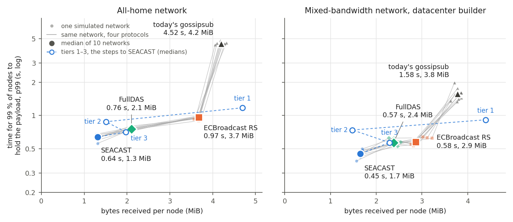

# SEACAST update 1: Figures 4 and 5 on the fixed code, FullDAS, a second simulator, larger networks

The record behind version 1 of [SEACAST's living text](../../README.md), measured 2026-10-22 to 2026-10-25 and recorded
2026-10-26. The text carries on
[*SEACAST: fast, lean broadcast for Ethereum, with an executable spec and a formal model*](https://ethresear.ch/t/seacast-fast-lean-broadcast-for-ethereum-with-an-executable-spec-and-a-formal-model/26167)
(2026). SEACAST's specification and releases: [informed-diffusion-spec](https://github.com/cskiraly/informed-diffusion-spec).

Every result here is the median over ten simulated networks of each kind, 500 nodes with 16 connections each (FullDAS
also opens short-lived connections for its samples) and a 1 MiB payload unless the row says otherwise: the all-home network, every node at 50 Mbps up and 100 down, and the
mixed-bandwidth network (dcb20), a fifth of the nodes at 1 Gbps, the builder among them. Time is the median over the
five payloads after the first of the time by which 99 % of the nodes can rebuild the payload; bytes are what a node
receives on the wire until the last node completes, QUIC headers and control included.

## 1. Figures 4 and 5 on the fixed code

The post's Figures 4 and 5 came from the implementation before the specification's version 0.5 fixes and the two
fixes described in the post's §5. Both were rerun on the fixed code, with the source's paced HAVE. The time stays
within the spread between runs at every setting; the bytes fall a little, consistently only on the thinner links,
where each of the ten networks gets lighter (SEACAST; Figure 4 at 50 Mbps, Figure 5 below it):

| setting | time, before → after | networks faster | bytes, before → after | networks lighter |
|---|---|---|---|---|
| all-home, 50 Mbps | 0.645 → 0.638 s | 9 of 10 | 1.327 → 1.314 MiB | 7 of 10 |
| dcb20 | 0.454 → 0.449 s | 4 of 10 | 1.706 → 1.651 MiB | 5 of 10 |
| all-home, 25 Mbps | 0.938 → 0.924 s | 6 of 10 | 1.294 → 1.284 MiB | 7 of 10 |
| all-home, 20 Mbps | 1.083 → 1.067 s | 6 of 10 | 1.280 → 1.264 MiB | 10 of 10 |
| all-home, 10 Mbps | 1.788 → 1.776 s | 7 of 10 | 1.299 → 1.266 MiB | 10 of 10 |

Figure 5 after the rerun: [`figures/seacast_elastic_all.png`](figures/seacast_elastic_all.png), its data
[`data/seacast_elastic_all.csv`](data/seacast_elastic_all.csv), and the lower bound per network
[`data/seacast_elastic_all_bound.tsv`](data/seacast_elastic_all_bound.tsv).

## 2. FullDAS in Figure 4



FullDAS ([*FullDAS: towards massive scalability with 32MB blocks and beyond*](https://ethresear.ch/t/fulldas-towards-massive-scalability-with-32mb-blocks-and-beyond/19529),
2024) with every node sampling every cell so that each ends with the whole payload: the chunks as an 8×8 grid
extended to 16×16 cells, each row and column a gossipsub topic on per-line random 8-regular graphs, one row and one
column of custody per node (FullDAS's own configuration holds two of each, about 32 connections per node), and the
source publishing its cells in a random order, as that configuration does. The other protocols run on the harness's
16-connection graph; FullDAS keeps its own graphs.

| network | SEACAST | FullDAS | ECBroadcast RS | gossipsub |
|---|---|---|---|---|
| all-home | 0.638 s, 1.31 MiB | 0.756 s, 2.10 MiB | 0.967 s, 3.67 MiB | 4.521 s, 4.20 MiB |
| dcb20 | 0.449 s, 1.65 MiB | 0.569 s, 2.38 MiB | 0.577 s, 2.86 MiB | 1.584 s, 3.78 MiB |

SEACAST is faster and lighter than FullDAS on each of the ten networks of both kinds. Per network:
[`data/seacast_compare.csv`](data/seacast_compare.csv).

## 3. A second simulator: Shadow

SEACAST over QUIC under [Shadow](https://shadow.github.io/), on Figure 4's networks with Figure 4's code
([`data/seacast_shadow_500.csv`](data/seacast_shadow_500.csv)):

| network | Shadow | our simulator | Shadow faster | bytes, Shadow / ours |
|---|---|---|---|---|
| all-home | 0.596 s | 0.638 s | 10 of 10 networks | 1.330 / 1.314 MiB |
| dcb20 | 0.440 s | 0.449 s | 8 of 10 | 1.659 / 1.651 MiB |

Today's gossipsub under Shadow ([`data/gossipsub_shadow_500.csv`](data/gossipsub_shadow_500.csv)): 3.47 s and
3.40 MiB on the all-home network, 1.44 s and 3.15 MiB with a datacenter builder, against 4.52 s and 4.20 MiB, and
1.58 s and 3.78 MiB, in ours. Gossipsub takes 5.8 times SEACAST's time and 2.6 times its bytes under Shadow on the
all-home network (7.1 and 3.2 times in ours), and 3.3 and 1.9 times with a datacenter builder (3.5 and 2.3).

The difference traced between the simulators is the uplink queue: ours shares a node's uplink among its connections
and drops packets that wait longer than its target, as Linux's fq_codel does; Shadow serves one queue in arrival
order and drops nothing. Figure 4 rerun in our simulator with Shadow's queue, one first-in, first-out queue per link
without drops ([`data/figure4_fifo_queue.csv`](data/figure4_fifo_queue.csv); SEACAST on its code from before version
0.5's fixes):

| network | protocol | FIFO queue | fq_codel (Figure 4) | bytes, FIFO / fq_codel |
|---|---|---|---|---|
| all-home | SEACAST | 0.603 s | 0.645 s | 1.349 / 1.327 MiB |
| all-home | ECBroadcast RS | 0.985 s | 0.967 s | 4.627 / 3.671 MiB |
| all-home | gossipsub | 3.553 s | 4.521 s | 3.427 / 4.199 MiB |
| dcb20 | SEACAST | 0.426 s | 0.454 s | 1.625 / 1.706 MiB |
| dcb20 | ECBroadcast RS | 0.696 s | 0.577 s | 3.700 / 2.862 MiB |
| dcb20 | gossipsub | 1.259 s | 1.584 s | 3.176 / 3.776 MiB |

Under either queue SEACAST is faster and lighter than both on each of the ten networks of both kinds.

## 4. Larger networks

SEACAST in our simulator at 500, 1000 and 2000 nodes, ten networks of each kind at each size, with Figure 4's code
and settings ([`data/seacast_scale.csv`](data/seacast_scale.csv)). A network differs with its size, so sizes are not
paired. At 1000 nodes on the all-home network, the network of seed 17 replaces that of seed 12, which failed the
simulator's mesh check before its first payload.

| network | 500 nodes | 1000 nodes | 2000 nodes |
|---|---|---|---|
| all-home | 0.643 s, 1.31 MiB | 0.687 s, 1.30 MiB | 0.690 s, 1.32 MiB |
| dcb20 | 0.442 s, 1.65 MiB | 0.484 s, 1.69 MiB | 0.500 s, 1.72 MiB |

## Files

- `figures/`: Figure 4 with FullDAS and Figure 5 after the rerun, as the reply and this record show them.
- `data/`: one row per network (seed) and protocol. `data/post/`: the data behind the post's Figures 4 and 5 as
  published, which §1 and §3 compare with.
- `scripts/`, the figures' plotting scripts (matplotlib):
  `python3 scripts/seacast_compare.py --csv data/seacast_compare.csv --out figures/seacast_compare.png` and
  `python3 scripts/seacast_elastic_all.py --csv data/seacast_elastic_all.csv --out figures/seacast_elastic_all.png`.
  Figure 5's lower-bound line is the median over the ten networks, written into the second script; its per-network
  values are `data/seacast_elastic_all_bound.tsv`.
- `scripts/bound/`, Figure 5's lower bound, from the networks' model alone (no cell runs):
  `python3 scripts/bound/figure_bound.py --record data/seacast_elastic_all_bound.tsv` (about two minutes; Go builds
  `graphgen/`, our simulator's graph generator, copied verbatim). Its inputs are `data/payload-sizes.tsv`, each
  payload's sizes as our simulator builds them (`go run . -n 1048576 -k 64 -msgs 6` in `scripts/bound/payloadsize/`),
  and the networks' latencies and links from `scenario.py`, the specification's `toy/scenario.py` at v0.6. The
  bound's derivation is in the docstrings of `overlay_bound.py` and `simple_bound.py`. Rerun for this record, both
  files come out byte for byte.
- `scripts/`, the scripts that wrote the other data files from the cells' logs and records (not published; a
  record is a cell's log read by `msgextract.py`, `testing/shadowstudy/msgextract.py` in prysm snapshot
  `d891c63c40`). Each was rerun on them for this record and gives its file byte for byte:
  - `tenseeds.py LOGDIR --out DIR`, with `v05read.py`: §1's table from the rerun's logs and `data/post/`, and
    `data/seacast_elastic_all.csv` and `data/seacast_compare.csv`, the latter without its FullDAS rows.
  - `read_fd.py --csv NETWORK,fulldas LOG...`: the FullDAS rows at the end of `data/seacast_compare.csv`. It reads
    any protocol's cell as Figure 4 does; on the post's gossipsub cells it gives `data/post/`'s rows exactly.
  - `lane_compare.py --shadow-dir DIR --harness-dir DIR --msgextract PATH --csv data/seacast_shadow_500.csv`: §3's
    first table. It prints dcb20's median in our simulator, 0.4485 s, as 448 ms; the table rounds it to 0.449 s.
  - `gs_compare.py --gs-dir DIR --csv data/gossipsub_shadow_500.csv`: gossipsub under Shadow, and the ratios in §3.
  - `fifo_compare.py --fifo-dir DIR --msgextract PATH --out data/figure4_fifo_queue.csv`: §3's last table.
  - `scale_compare.py --scale-dir DIR --replace 1000:home:12:17 --record data/seacast_scale.csv`: §4's table.
- The scripts that launched the cells are not published; each cell's code and settings are in Code below.

## Code

Snapshots on prysm's [`payload-segmentation-snapshot`](https://github.com/cskiraly/prysm/tree/payload-segmentation-snapshot)
branch, one per research tree the cells ran: each is that tree without its `notes/` folder, plus `testing/segstudy` from
the snapshot before it, with code comments that cited unpublished notes rewritten without the citation (no code
changes); its message names the research commit. As in the earlier snapshots, the library forks the
builds replaced are vendored under `third_party/`, and [eth-networking-lab](https://github.com/cskiraly/eth-networking-lab)
is expected beside the tree, at its tag
[`seacast-u1-2026-10`](https://github.com/cskiraly/eth-networking-lab/tree/seacast-u1-2026-10) (`aa43baf`): the
revision every Shadow build of this record was built with, and one every snapshot here compiles with.

| what | prysm snapshot (research commit) | settings |
|---|---|---|
| gossipsub, ECBroadcast's Reed–Solomon mode (ethp2p's engine, vendored unmodified) and tiers 1–3, Figures 4 and 5 | `fe605ca7e3` (`4fd3f2b8d5`) | as published with the post |
| SEACAST, Figures 4 and 5 after the rerun | `101d06cc79` (`589bf05d4b`) | version 0.5's rules (`SEGMENT_V05=all`), the source's paced HAVE (`SEGMENT_SRC_HAVE=paced`) |
| FullDAS, Figure 4 | `8b8e60640a` (`b7127336b2`, on `4fd3f2b8d5`) | the source's random publish order (`SEGMENT_FULLDAS_ORDER=random`), after [das-simulator-nim](https://github.com/cskiraly/das-simulator-nim) `0e2810a11` and `34ba9ff` |
| SEACAST under Shadow, and at 1000 and 2000 nodes | `7d4ed67d70` (`6806fef1f1`, `589bf05d4b` merged) | as SEACAST above; Shadow 3.3.0 with this repository's `shadow-patches`, as in its tag `shadow-crosscheck` |
| gossipsub under Shadow | `d891c63c40` (`f4cde64688`) | as gossipsub above |
| Figure 4 with Shadow's queue | `4b732cb7d7` (`ed78d0a904`) | each arm as in Figure 4, plus `SIMNET_FLOW_BUCKETS=1 SIMNET_CODEL_TARGET_MS=100000`; SEACAST without the rerun's rules |

The specification these measurements compare with is version 0.5 of its text (its release v0.6.1, whose §9 says where
the rerun's implementation does as the text does); later releases change the text, not these measurements.

**Cite as.** Csaba Kiraly, "SEACAST: fast, lean broadcast for Ethereum, with an executable spec and a formal model",
ethresear.ch, 21 October 2026, <https://ethresear.ch/t/seacast-fast-lean-broadcast-for-ethereum-with-an-executable-spec-and-a-formal-model/26167>,
update 1. Data and code: <https://github.com/cskiraly/eth-networking-studies>, tag `seacast-u1`.

<details><summary>BibTeX</summary>

```bibtex
@misc{kiraly2026seacastu1,
  author       = {Kiraly, Csaba},
  title        = {{SEACAST}: fast, lean broadcast for {Ethereum}, with an executable spec and a formal model},
  howpublished = {ethresear.ch},
  year         = {2026},
  month        = oct,
  url          = {https://ethresear.ch/t/seacast-fast-lean-broadcast-for-ethereum-with-an-executable-spec-and-a-formal-model/26167},
  note         = {Update 1. Data and code: \url{https://github.com/cskiraly/eth-networking-studies}, tag seacast-u1}
}
```
</details>
