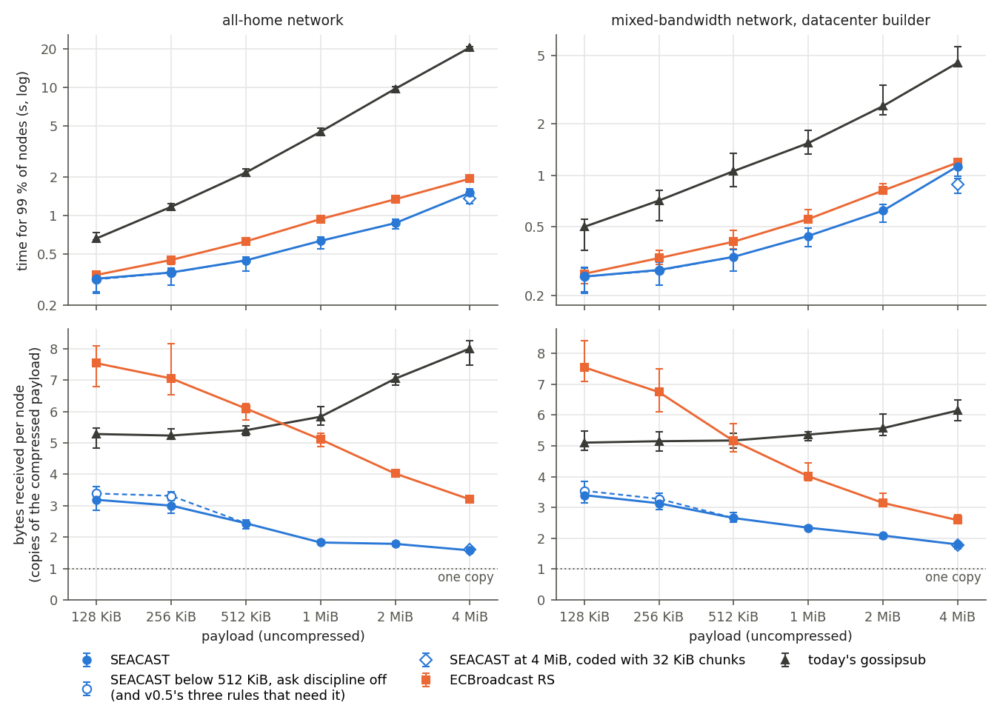

# SEACAST update 2: payload size, the specification's versions 0.9 to 0.10.2, and an account of the proofs

The record behind version 2 of [SEACAST's living text](../../README.md), measured 2026-11-16. The text carries on
[*SEACAST: fast, lean broadcast for Ethereum, with an executable spec and a formal model*](https://ethresear.ch/t/seacast-fast-lean-broadcast-for-ethereum-with-an-executable-spec-and-a-formal-model/26167)
(2026). SEACAST's specification and releases: [informed-diffusion-spec](https://github.com/cskiraly/informed-diffusion-spec);
version 2 of the text describes its release [v0.10.2](https://github.com/cskiraly/informed-diffusion-spec/tree/v0.10.2).

## 1. Figure 6: payload size



Today's gossipsub, ECBroadcast's Reed–Solomon mode and SEACAST at 128, 256 and 512 KiB, 1, 2 and 4 MiB, on Figure 4's
two networks: 500 nodes with 16 connections each, the all-home network (every node at 50 Mbps up and 100 down) and the
mixed-bandwidth network (dcb20: a fifth of the nodes at 1 Gbps, the builder among them), seeds 7 to 16, Figure 4's.
The seeds give each network its own graph and its own placement of nodes in regions, but nearly one split of the 500
nodes among the regions: a node's region is drawn from `seed ^ constant ^ node index` (eth-networking-lab's
`gossipsim/geo.go`), which for seeds below 512 covers nearly the same inputs at every seed. Each cell is
six payloads, a slot apart; its time is the median over the five payloads after the first of the time by which 99 %
of the nodes can rebuild the payload (for gossipsub, hold it), and its bytes what a node receives on the wire until
the last node completes, as in Figure 4. The figure's bytes are in copies of that size's compressed payload (0.089,
0.178, 0.356, 0.711, 1.423 and 2.841 MiB).

Every point has ten networks (`data/sizes.csv`, one row per network).

**Settings**, Figure 4's apart from the payload's size and these:

| | at every size | varied by size |
|---|---|---|
| SEACAST | Figure 4's: version 0.5's rules (`SEGMENT_V05=all`), the source's paced HAVE (`SEGMENT_SRC_HAVE=paced`), compressed first, coded K + K | push budget R = 4 at 256 KiB and below, 3 at 512 KiB, 2 from 1 MiB (6 for nodes at 1 Gbps), as the earlier posts' size sweeps; K = payload / 16 KiB (8 to 128 data chunks) |
| SEACAST at 4 MiB | | K = 256 would make 512 chunks, over the specification's `MAX_CHUNKS` = 256: as the specification's `build_group`, a plain group of 256 chunks, not compressed first (each chunk is compressed on the wire); **variant**, coded with K = 128 (`UNIT` = 32 KiB) |
| SEACAST below 512 KiB | the ask discipline on (one announcer at a time, the offer table, parking), as at 512 KiB and above | **variant**, as the earlier posts' runner left it below 512 KiB: the discipline off, and with it version 0.5's rules e, b and c, which need parking (only a, conn and d on) |
| ECBroadcast RS | Figure 4's: ethp2p's engine unmodified, 16 KiB chunks, as many parity as data, `ForwardMultiplier` 4, the compressed payload | |
| gossipsub | Figure 4's: the whole compressed payload as one message, stock IDONTWANT | at 2 and 4 MiB the payloads 40 s apart instead of 12 (below) |

**Known answers.** Before its cells, each machine reran Figure 4's seed-7 cell at 1 MiB on one or both networks:

| machine | network | protocol | Figure 4 | this run | bound |
|---|---|---|---|---|---|
| A | all-home | SEACAST | 0.644 s, 1.2949 MiB | 0.676 s (+5.0 %), 1.2819 MiB (−1.0 %) | ±6 %, ±2 % |
| A | all-home | ECBroadcast RS | 0.985 s, 3.6107 MiB | 0.995 s (+1.0 %), 3.7782 MiB (+4.6 %) | ±6 %, ±5 % |
| A | all-home | gossipsub | 4.391 s, 4.0549 MiB | 4.403 s (+0.3 %), 4.0289 MiB (−0.6 %) | ±10 %, ±3 % |
| A | dcb20 | SEACAST | 0.482 s, 1.6886 MiB | 0.479 s (−0.6 %), 1.6980 MiB (+0.6 %) | ±8 %, ±3 % |
| A | dcb20 | ECBroadcast RS | 0.640 s, 3.0201 MiB | 0.614 s (−4.1 %), 3.0336 MiB (+0.4 %) | ±8 %, ±5 % |
| A | dcb20 | gossipsub | 1.608 s, 3.8592 MiB | 1.602 s (−0.4 %), 3.7922 MiB (−1.7 %) | ±12 %, ±3 % |
| B | dcb20 | SEACAST | 0.482 s, 1.6886 MiB | 0.475 s (−1.5 %), 1.6803 MiB (−0.5 %) | ±8 %, ±3 % |
| B | dcb20 | ECBroadcast RS | 0.640 s, 3.0201 MiB | 0.606 s (−5.3 %), 2.9642 MiB (−1.9 %) | ±8 %, ±5 % |
| B | dcb20 | gossipsub | 1.608 s, 3.8592 MiB | 1.639 s (+1.9 %), 3.8834 MiB (+0.6 %) | ±12 %, ±3 % |
| C | dcb20 | gossipsub | 1.608 s, 3.8592 MiB | 1.624 s (+1.0 %), 3.7780 MiB (−2.1 %) | ±12 %, ±3 % |

The bounds were set before the runs: the simulator's run-to-run spread at 1 MiB, wider for the mixed network and for
the congested whole-message cell. The all-home network's cells ran on machine A, the mixed network's on machine B
(`machine` in `data/sizes.csv`), apart from these: gossipsub's cells at 4 MiB on the mixed network, and at 2 and
4 MiB on the all-home network for seeds 10 to 16, ran on machine C; ECBroadcast's cell at 4 MiB on the mixed
network for seed 16 ran on machine A, after its run on B was stopped when another user's job left too little memory.
Cross-host check: gossipsub at 2 MiB, mixed network, seed 7, gave 2.727 s and 8.582 MiB on B and 2.851 s (+4.5 %) and
8.454 MiB (−1.5 %) on C. Machine C has no check of its own on the all-home network. There, at 4 MiB, its seven
gossipsub cells (seeds 10 to 16) received 21.21 to 23.03 MiB, all below A's three (seeds 7 to 9, 23.17 to 23.48 MiB),
which may be the seeds or the machine; their times overlap (20.47 to 20.86 s against 20.19 to 20.63 s), as do both
at 2 MiB. On A's cells alone gossipsub's 4 MiB point would be 8.2 copies, on C's 7.8, against 8.0 for all ten.

**gossipsub's gap.** At 4 MiB, seed 7, on the all-home network, gossipsub took 21.05 s and 28.30 MiB with payloads
12 s apart, which then overlap, against 20.19 s and 23.48 MiB at 40 s; its 2 and 4 MiB cells run at 40 s.

**The offer table's bound.** The pubsub fork remembers at most 256 announcements a peer for chunks the node has not
received (the specification's bound on offers). A node that rebuilds a coded group never receives the group's other
chunks, and their announcements stay until they age out after 30 s or the group expires, so across payloads a slot
apart they can fill a peer's 256 places. Rerun on a later build with a counter that only observes (seed 7, the
figure's settings, times and bytes within the bounds above), the bound turned away none of about half a million
announcements at 1 MiB, none and 46 of about a million at 2 MiB, and 29 and 64 at 4 MiB coded with 32 KiB chunks
(all-home, mixed). The figure includes whatever these cost.

**Results** (medians over the networks; `data/sizes.csv` per network, `scripts/summary.py` for these tables):

```
compressed payload, MiB: 128 KiB 0.089, 256 KiB 0.178, 512 KiB 0.356, 1024 KiB 0.711, 2048 KiB 1.423, 4096 KiB 2.841

== all-home: series, size: n, time median [min-max] s, copies median [min-max]
  ecbroadcast-rs     128: n 10, 0.344 [0.314-0.365] s, 7.54 [6.79-8.09] copies
  ecbroadcast-rs     256: n 10, 0.451 [0.418-0.470] s, 7.05 [6.54-8.16] copies
  ecbroadcast-rs     512: n 10, 0.629 [0.592-0.662] s, 6.09 [5.72-6.26] copies
  ecbroadcast-rs    1024: n 10, 0.940 [0.912-0.995] s, 5.11 [4.89-5.32] copies
  ecbroadcast-rs    2048: n 10, 1.343 [1.301-1.384] s, 4.02 [3.94-4.08] copies
  ecbroadcast-rs    4096: n 10, 1.946 [1.909-1.982] s, 3.20 [3.18-3.27] copies
  gossipsub          128: n 10, 0.664 [0.643-0.735] s, 5.28 [4.84-5.48] copies
  gossipsub          256: n 10, 1.172 [1.121-1.246] s, 5.23 [5.12-5.44] copies
  gossipsub          512: n 10, 2.175 [2.049-2.320] s, 5.40 [5.23-5.54] copies
  gossipsub         1024: n 10, 4.527 [4.277-4.845] s, 5.83 [5.57-6.15] copies
  gossipsub         2048: n 10, 9.806 [9.570-10.128] s, 7.05 [6.85-7.20] copies
  gossipsub         4096: n 10, 20.608 [20.190-20.862] s, 8.00 [7.47-8.26] copies
  seacast            512: n 10, 0.447 [0.367-0.477] s, 2.44 [2.27-2.54] copies
  seacast           1024: n 10, 0.635 [0.551-0.678] s, 1.83 [1.79-1.90] copies
  seacast           2048: n 10, 0.874 [0.785-0.933] s, 1.78 [1.75-1.83] copies
  seacast/all        128: n 10, 0.322 [0.253-0.342] s, 3.19 [2.86-3.48] copies
  seacast/all        256: n 10, 0.359 [0.286-0.383] s, 3.00 [2.75-3.15] copies
  seacast/plain     4096: n 10, 1.510 [1.384-1.627] s, 1.58 [1.53-1.58] copies
  seacast/runner     128: n 10, 0.318 [0.248-0.343] s, 3.39 [3.22-3.60] copies
  seacast/runner     256: n 10, 0.358 [0.288-0.387] s, 3.31 [3.21-3.43] copies
  seacast/unit32    4096: n 10, 1.357 [1.237-1.445] s, 1.60 [1.57-1.63] copies

== dcb20: series, size: n, time median [min-max] s, copies median [min-max]
  ecbroadcast-rs     128: n 10, 0.267 [0.235-0.290] s, 7.55 [7.09-8.42] copies
  ecbroadcast-rs     256: n 10, 0.330 [0.304-0.365] s, 6.74 [6.10-7.49] copies
  ecbroadcast-rs     512: n 10, 0.410 [0.372-0.479] s, 5.16 [4.81-5.71] copies
  ecbroadcast-rs    1024: n 10, 0.556 [0.530-0.631] s, 4.01 [3.86-4.45] copies
  ecbroadcast-rs    2048: n 10, 0.815 [0.777-0.897] s, 3.15 [3.12-3.46] copies
  ecbroadcast-rs    4096: n 10, 1.187 [1.092-1.241] s, 2.59 [2.56-2.76] copies
  gossipsub          128: n 10, 0.501 [0.366-0.557] s, 5.10 [4.85-5.49] copies
  gossipsub          256: n 10, 0.712 [0.546-0.817] s, 5.15 [4.83-5.45] copies
  gossipsub          512: n 10, 1.058 [0.856-1.337] s, 5.17 [4.93-5.40] copies
  gossipsub         1024: n 10, 1.539 [1.324-1.835] s, 5.36 [5.16-5.46] copies
  gossipsub         2048: n 10, 2.529 [2.259-3.341] s, 5.57 [5.34-6.03] copies
  gossipsub         4096: n 10, 4.521 [4.334-5.598] s, 6.14 [5.82-6.48] copies
  seacast            512: n 10, 0.335 [0.276-0.371] s, 2.66 [2.51-2.82] copies
  seacast           1024: n 10, 0.444 [0.386-0.492] s, 2.34 [2.26-2.40] copies
  seacast           2048: n 10, 0.622 [0.535-0.679] s, 2.09 [2.00-2.13] copies
  seacast/all        128: n 10, 0.257 [0.209-0.290] s, 3.40 [3.14-3.51] copies
  seacast/all        256: n 10, 0.281 [0.229-0.319] s, 3.13 [2.93-3.34] copies
  seacast/plain     4096: n 10, 1.127 [0.987-1.190] s, 1.80 [1.67-1.84] copies
  seacast/runner     128: n 10, 0.258 [0.206-0.288] s, 3.54 [3.15-3.84] copies
  seacast/runner     256: n 10, 0.279 [0.229-0.313] s, 3.28 [3.07-3.47] copies
  seacast/unit32    4096: n 10, 0.883 [0.783-0.956] s, 1.77 [1.66-1.81] copies

== all-home: SEACAST as specified against each series, paired by network
    128: ecbroadcast-rs: faster 10/10, lighter 10/10; gossipsub: faster 10/10, lighter 10/10; seacast/runner: faster 3/10, lighter 9/10
    256: ecbroadcast-rs: faster 10/10, lighter 10/10; gossipsub: faster 10/10, lighter 10/10; seacast/runner: faster 8/10, lighter 10/10
    512: ecbroadcast-rs: faster 10/10, lighter 10/10; gossipsub: faster 10/10, lighter 10/10
   1024: ecbroadcast-rs: faster 10/10, lighter 10/10; gossipsub: faster 10/10, lighter 10/10
   2048: ecbroadcast-rs: faster 10/10, lighter 10/10; gossipsub: faster 10/10, lighter 10/10
   4096: ecbroadcast-rs: faster 10/10, lighter 10/10; gossipsub: faster 10/10, lighter 10/10; seacast/unit32: faster 0/10, lighter 10/10

== dcb20: SEACAST as specified against each series, paired by network
    128: ecbroadcast-rs: faster 6/10, lighter 10/10; gossipsub: faster 10/10, lighter 10/10; seacast/runner: faster 3/10, lighter 10/10
    256: ecbroadcast-rs: faster 10/10, lighter 10/10; gossipsub: faster 10/10, lighter 10/10; seacast/runner: faster 5/10, lighter 10/10
    512: ecbroadcast-rs: faster 10/10, lighter 10/10; gossipsub: faster 10/10, lighter 10/10
   1024: ecbroadcast-rs: faster 10/10, lighter 10/10; gossipsub: faster 10/10, lighter 10/10
   2048: ecbroadcast-rs: faster 10/10, lighter 10/10; gossipsub: faster 10/10, lighter 10/10
   4096: ecbroadcast-rs: faster 9/10, lighter 10/10; gossipsub: faster 10/10, lighter 10/10; seacast/unit32: faster 0/10, lighter 0/10
```

## Files

- `figures/seacast_sizes.png`: Figure 6.
- `data/sizes.csv`: one row per cell in the figure: machine, network, protocol, payload (KiB), seed, gossipsub's gap,
  the SEACAST variant (`disc`: `all` with the ask discipline below 512 KiB, `runner` without; `shape`: `plain` or
  `unit32` at 4 MiB), whether the cell passed and its payload count, the time (`p99_s`), the bytes (`mib`), the
  slowest warm payload's time, ECBroadcast's compressed payload size, and the cell's log tag.
- `data/checks.csv`, in the same columns: the cells outside the figure, which are machine A's three known answers on
  the mixed network, machine C's known answer, machine C's side of the cross-host check and the 12 s gap trial. The
  other known answers' cells, and machine B's side of the cross-host check, are rows of `data/sizes.csv`.
- `scripts/seacast_sizes.py`: the figure (matplotlib):
  `python3 scripts/seacast_sizes.py --csv data/sizes.csv --out figures/seacast_sizes.png --gs-gap 40000`.
- `scripts/summary.py`: the tables above, `python3 scripts/summary.py data/sizes.csv`.

## Code

As in the [record of update 1](../u1/README.md): SEACAST ran on prysm snapshot `101d06cc79` (research commit
`589bf05d4b`), gossipsub and ECBroadcast RS on `fe605ca7e3` (`4fd3f2b8d5`), on
[`payload-segmentation-snapshot`](https://github.com/cskiraly/prysm/tree/payload-segmentation-snapshot). The test is
`TestQ6RealisticMesh`; the payload size is `SEGMENT_PAYLOAD_BYTES`, the push budget `SEGMENT_A_PHASE_R`, the 4 MiB
variants `SEGMENT_FIXED_COUNT`, `SEGMENT_PARITY` and `SEGMENT_COMPRESS_FIRST`, the discipline `SEGMENT_IWANT_DISCIPLINE_MS`,
`SEGMENT_OFFER_TABLE` and `SEGMENT_IHAVE_PARK*`, the v0.5 rules `SEGMENT_V05`, gossipsub's gap `SEGMENT_MESSAGE_GAP_MS`.
